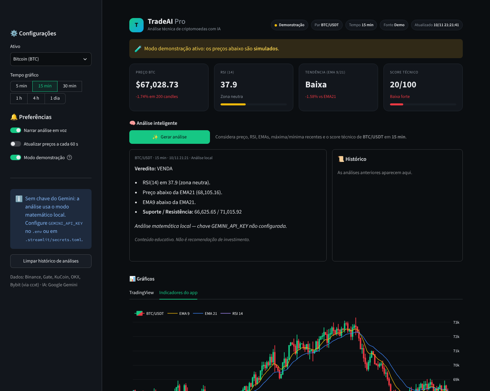

# 📈 TradeAI Pro

Dashboard de análise técnica de criptomoedas com IA. Mostra preço, RSI, médias móveis e um score técnico
em tempo real, gera um parecer com o **Google Gemini** (com narração em voz) e traz o gráfico do TradingView.



## Recursos

- **Dados ao vivo** de várias corretoras (Binance, Gate, KuCoin, OKX, Bybit) com troca automática se uma falhar.
- **Indicadores**: RSI(14) com suavização de Wilder, EMA 9 e EMA 21, máxima/mínima recentes.
- **Score técnico 0–100** que combina RSI, posição do preço e cruzamento das médias, com os motivos explicados.
- **Análise por IA** (Gemini) com rotação de modelos; sem chave ou sem cota, usa uma análise matemática local.
- **Narração** da análise em português (edge-tts).
- **Histórico** das últimas 10 análises.
- **Gráficos**: TradingView e um gráfico próprio (candles + EMAs + RSI).
- **Atualização automática** opcional a cada 60 s e **modo demonstração** com dados simulados.

## Como rodar

```bash
python -m venv .venv
source .venv/bin/activate        # Windows: .venv\Scripts\activate
pip install -r requirements.txt
cp .env.example .env             # e coloque sua GEMINI_API_KEY
streamlit run main.py
```

A chave do Gemini é gratuita em <https://aistudio.google.com/apikey>. No Streamlit Community Cloud,
use `.streamlit/secrets.toml` (veja `.streamlit/secrets.toml.example`).

| Variável | Para que serve |
|---|---|
| `GEMINI_API_KEY` | Chave do Google Gemini (opcional: sem ela o app usa a análise local) |
| `GEMINI_MODELS` | Lista de modelos separados por vírgula, na ordem de tentativa |
| `TRADEAI_DEMO` | `1` abre o app já em modo demonstração |

## Testes

```bash
pip install -r requirements-dev.txt
ruff check .
pytest
```

Os testes não acessam a internet: corretoras, Gemini e narração são simulados. Há testes de unidade para
indicadores, serviços e componentes visuais, e testes de ponta a ponta da interface com o `AppTest` do Streamlit.
O GitHub Actions roda tudo em Python 3.10, 3.12 e 3.13 a cada push e pull request.

## Estrutura

```
main.py              # interface Streamlit
tradeai/
  indicators.py      # RSI, EMA, score, normalização de símbolos (funções puras)
  market.py          # coleta de dados com fallback entre corretoras + modo demo
  ai.py              # Gemini com rotação de modelos e análise offline
  audio.py           # narração com edge-tts
  ui.py              # CSS, cards, cabeçalho e gráficos
tests/               # pytest
```

## Aviso

Conteúdo educativo. Nada aqui é recomendação de investimento. Criptoativos são voláteis: opere com gestão de risco.
